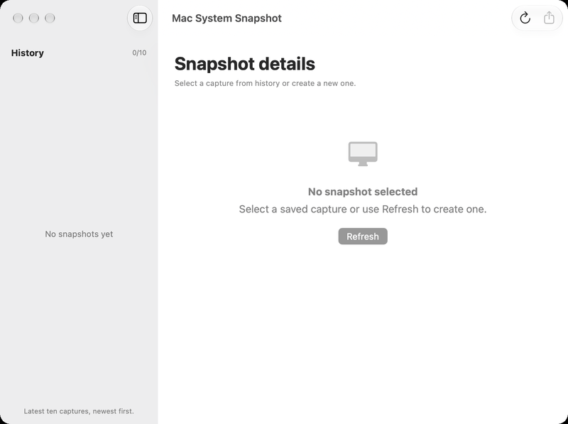
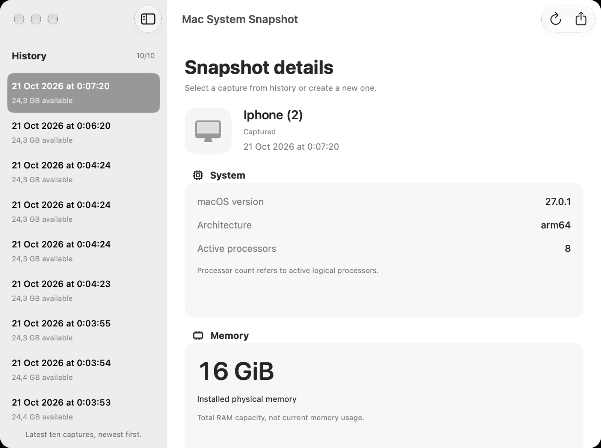
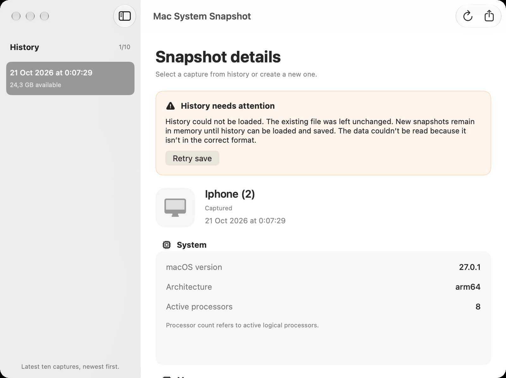
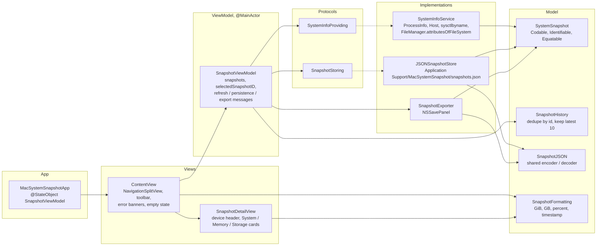
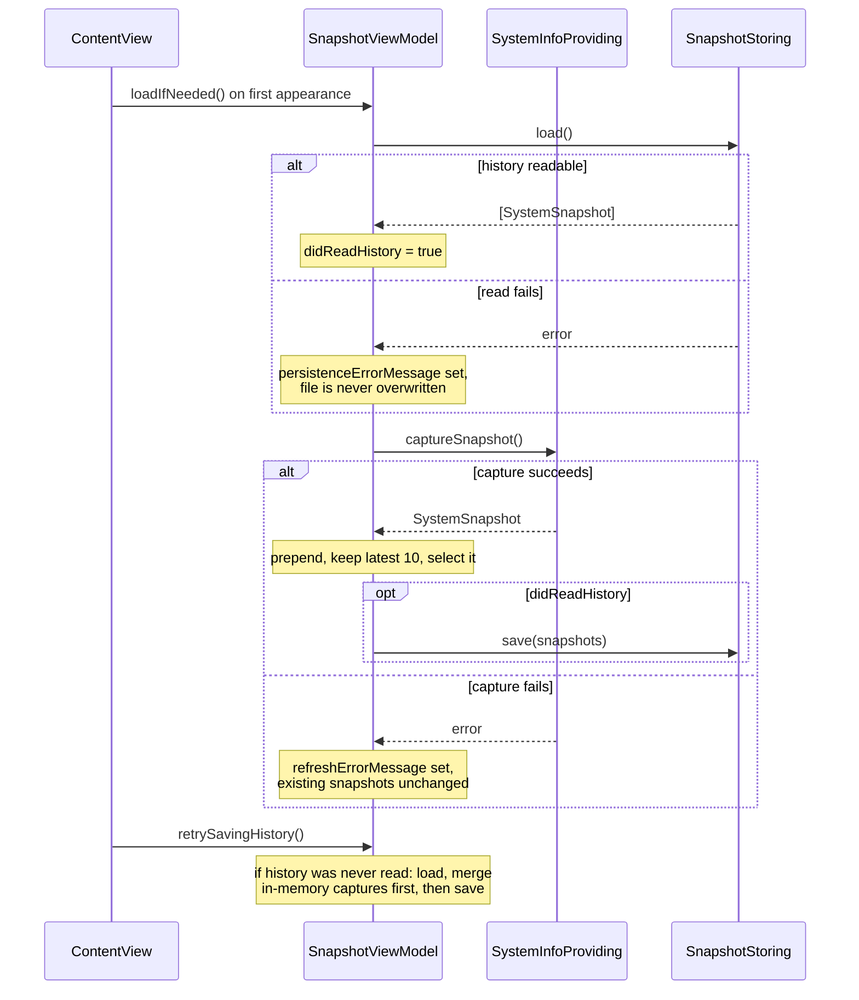

# Mac System Snapshot

A small native macOS app, written in Swift and SwiftUI, that captures a point-in-time snapshot
of the Mac it runs on: device name, macOS version, processor architecture and active core
count, installed memory, and total and available disk space. Each capture is kept in a
ten-entry history persisted as JSON inside the App Sandbox container, can be re-selected from
a sidebar, and exported as a standalone JSON file through the native save panel.

The project is deliberately narrow so that the interesting parts are visible: a protocol-driven
MVVM core, explicit error states for collection, persistence and export, and an XCTest suite
that exercises the ViewModel through injected fakes.

## Preview

Captures of the app built from this repository and running on macOS 27 (Apple silicon).







The storage card (available and total space with a progress bar and percentage) sits below the
memory card and is reached by scrolling.

## Features

- Captures device name, macOS version, `arm64`/`x86_64` architecture, active logical processor
  count, physical memory, and total and available space of the volume holding the home
  directory.
- Captures on first display and on demand (Refresh button or `⌘R`); the app does not poll.
- History of the latest ten captures, newest first, restored on launch and shown in a sidebar.
  Selecting an older row shows it without capturing or saving.
- Export of the selected snapshot as pretty-printed JSON through `NSSavePanel` (`⌘E`).
- Three independent error banners, each with its own retry: collection failed (previous
  snapshots unchanged), history could not be loaded or saved (captures stay in memory, file is
  never overwritten), export failed.
- App Sandbox enabled; the only file access outside the container is the user-selected export
  destination.
- Light and dark appearance, adaptive one- or two-column card layout, selectable values,
  minimum window size.

## Architecture



- **Dependency injection through protocols.** `SnapshotViewModel` receives a
  `SystemInfoProviding` and a `SnapshotStoring`. The app composes the real `SystemInfoService`
  and `JSONSnapshotStore` in `MacSystemSnapshotApp`; the tests pass a stub provider and an
  in-memory store to drive success and failure paths deterministically.
- **One owner for state.** The ViewModel is a `@MainActor` `ObservableObject` held in a
  `@StateObject` at the app level. Views observe it with `@ObservedObject`; all mutations happen
  on the main actor, which is also why the synchronous collection and the small file writes run
  there without extra synchronisation.
- **History rules in one place.** `SnapshotHistory.keepingLatest` deduplicates by UUID (first
  occurrence wins) and truncates to ten. It is applied on load, after each capture, on save and
  when merging after a recovered read failure, so every path agrees on what "the history" is.
- **Separate error channels.** Refresh, persistence and export each publish their own optional
  message, so a failed save does not hide a successful capture and the banners can offer the
  correct retry action.

### Refresh and persistence flow



### Data collection

| Value | Source | Notes |
| --- | --- | --- |
| Device name | `Host.current().localizedName` | Falls back to `Unknown Mac` when empty. |
| macOS version | `ProcessInfo.operatingSystemVersion` | Formatted as `major.minor.patch`. |
| Architecture | `sysctlbyname("hw.optional.arm64")` | Reports the hardware, not the process (so `arm64` even under Rosetta). Missing key on Intel maps to `x86_64`. |
| Active processors | `ProcessInfo.activeProcessorCount` | Logical cores currently active. |
| Physical memory | `ProcessInfo.physicalMemory` | Displayed in GiB (binary units). |
| Disk total / available | `FileManager.attributesOfFileSystem(forPath:)` for the home directory, `.systemSize` and `.systemFreeSize` | Displayed in GB (decimal units). Values are validated: total > 0, available ≤ total, otherwise the capture fails with `invalidDiskInformation`. |

`availableDiskFraction` is a computed property (0…1 or `nil`), so it never reaches the JSON.
Byte counts stay numeric in the model; formatting happens in `SnapshotFormatting` with the
current locale.

### Persistence and export

- History lives at `Application Support/MacSystemSnapshot/snapshots.json` inside the sandbox
  container, written atomically. `JSONSnapshotStore.load` treats a missing file as an empty
  history, and rejects files with duplicate ids or impossible disk values.
- Both history and export use `SnapshotJSON`: pretty-printed, sorted keys, dates as
  milliseconds since 1970. An exported file is one object; the history file is an array.
- Export writes only to the location chosen in the save panel; cancelling is not an error.

## Technology

| Component | Choice |
| --- | --- |
| Language / UI | Swift 5, SwiftUI (`NavigationSplitView`, `ContentUnavailableView`, `GroupBox`, `LazyVGrid`) |
| System access | Foundation (`ProcessInfo`, `Host`, `FileManager`), Darwin (`sysctlbyname`) |
| Reactive state | Combine `ObservableObject` / `@Published`, `@MainActor` |
| Export dialog | AppKit `NSSavePanel`, UniformTypeIdentifiers |
| Persistence | `Codable` + `JSONEncoder`/`JSONDecoder`, atomic file writes |
| Security | App Sandbox with user-selected read/write files; `PrivacyInfo.xcprivacy` declares the disk-space API reason |
| Tests | XCTest |

No third-party packages, shell subprocesses, networking or database.

## Getting started

### Requirements

- macOS 14.0 or later (deployment target of the app target).
- Xcode 15 or later with the macOS SDK. Verified with Xcode 26.0.1 on Apple silicon.

### Build and run

Open `MacSystemSnapshot.xcodeproj`, select the `MacSystemSnapshot` scheme and **My Mac**, and
press `⌘R`. Xcode's automatic signing with your development team is enough; the project already
has App Sandbox enabled with user-selected files set to read/write for the export panel.

From the command line, an ad-hoc signed debug build and the full test run look like this:

```bash
xcodebuild build -scheme MacSystemSnapshot -destination 'platform=macOS' \
  CODE_SIGN_IDENTITY=- CODE_SIGN_STYLE=Manual DEVELOPMENT_TEAM=

xcodebuild test -scheme MacSystemSnapshot -destination 'platform=macOS,arch=arm64' \
  CODE_SIGN_IDENTITY=- CODE_SIGN_STYLE=Manual DEVELOPMENT_TEAM=
```

If `xcodebuild` reports that the active developer directory is the Command Line Tools, prefix
the commands with `DEVELOPER_DIR=/Applications/Xcode.app/Contents/Developer`.

### Using the app

The app restores history and takes a capture on launch. `Refresh` (`⌘R`) adds another and
drops the oldest beyond ten. Select a row to inspect an earlier capture; `Export` (`⌘E`) saves
the selected one as JSON. If a banner appears, its button retries exactly the failed operation.

## Testing

```bash
xcodebuild test -scheme MacSystemSnapshot -destination 'platform=macOS,arch=arm64' \
  CODE_SIGN_IDENTITY=- CODE_SIGN_STYLE=Manual DEVELOPMENT_TEAM=
```

Or `⌘U` in Xcode. The suite has 16 tests in three files plus the two placeholder tests Xcode
generates in `MacSystemSnapshotTests.swift`; all 18 pass.

| Suite | Tests | What it checks |
| --- | ---: | --- |
| `SnapshotLogicTests` | 7 | Binary memory and decimal disk formatting with rounding, `availableDiskFraction` boundaries and invalid input, percentage formatting, JSON round trip including the millisecond timestamp and the absence of the computed property, history order and deduplication |
| `SnapshotStoreTests` | 4 | Missing file yields empty history, save then reload keeps ten, corrupt JSON throws and leaves the file byte-identical, impossible disk values are rejected |
| `SnapshotViewModelTests` | 5 | Launch loads, captures and saves; failed refresh keeps history and selection; failed save keeps the capture and retry persists it; failed load protects the file and retry merges; selecting an older snapshot neither captures nor saves |

`TestSupport.swift` provides a fixture builder, a stub provider whose result can be flipped
between success and failure, an in-memory store that counts save attempts, and a helper that
creates and removes a temporary directory per storage test. The real history directory is never
touched by tests. The save panel is not covered by automated tests.

## Project structure

```
Mac-System-Snaphot/
├── MacSystemSnapshot.xcodeproj
├── MacSystemSnapshot/
│   ├── MacSystemSnapshotApp.swift        # entry point, dependency composition, single window
│   ├── Models/
│   │   ├── SystemSnapshot.swift          # immutable Codable value, availableDiskFraction
│   │   └── SnapshotHistory.swift         # dedupe + ten-record limit
│   ├── Services/
│   │   ├── SystemInfoProviding.swift     # protocol
│   │   └── SystemInfoService.swift       # Foundation/Darwin collection, SystemInfoError
│   ├── Persistence/
│   │   ├── SnapshotStoring.swift         # protocol (@MainActor)
│   │   ├── SnapshotStore.swift           # JSONSnapshotStore: validation, atomic writes
│   │   └── SnapshotJSON.swift            # shared encoder/decoder settings
│   ├── Export/SnapshotExporter.swift     # NSSavePanel export
│   ├── Formatting/SnapshotFormatting.swift
│   ├── ViewModels/SnapshotViewModel.swift
│   ├── Views/
│   │   ├── ContentView.swift             # sidebar, toolbar, banners, empty state
│   │   └── SnapshotDetailView.swift      # header and cards
│   ├── PrivacyInfo.xcprivacy
│   └── Assets.xcassets
├── MacSystemSnapshotTests/
│   ├── TestSupport.swift
│   ├── SnapshotLogicTests.swift
│   ├── SnapshotStoreTests.swift
│   └── SnapshotViewModelTests.swift
└── docs/screenshots/
```

## Limitations

- **Not an atomic snapshot.** Values are read one after another; a capture is a few
  milliseconds wide, not a single OS-level snapshot.
- **Available space may differ from Finder.** `systemFreeSize` does not include purgeable
  space, so Finder's "available" figure is usually larger.
- **Main-thread I/O.** Collection and the history file write run synchronously on the main
  actor. This is fine for a ten-record JSON file and would need to move off the main thread
  for anything larger.
- **Window size is restored by the system.** The saved frame wins over the default 820×680
  size, so the storage card may start below the fold.
- **Test target deployment target.** The test target is set to macOS 26.0 while the app target
  is 14.0; the tests only run on recent systems.
- **Intel and Rosetta not verified.** Developed and tested on Apple silicon only.
